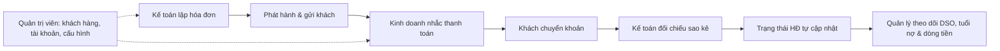
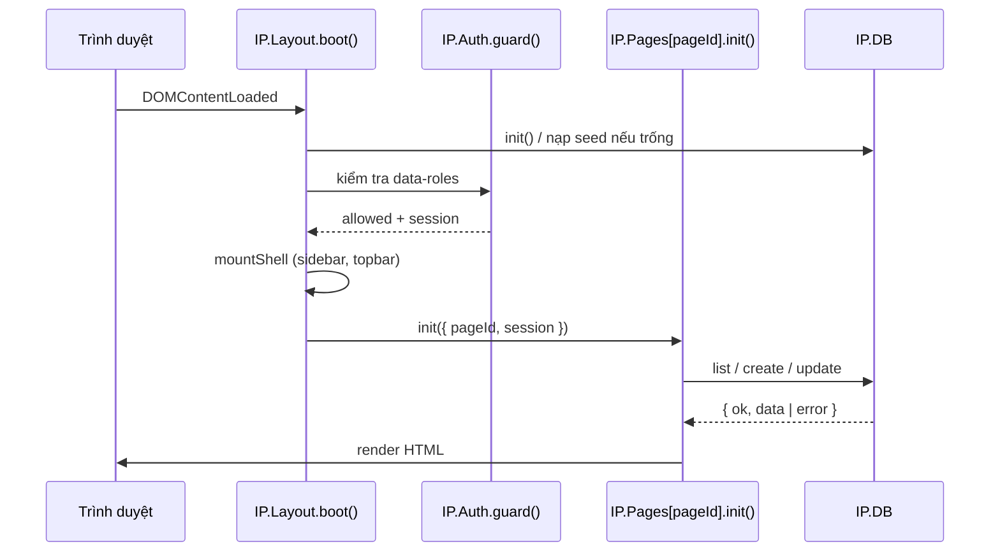
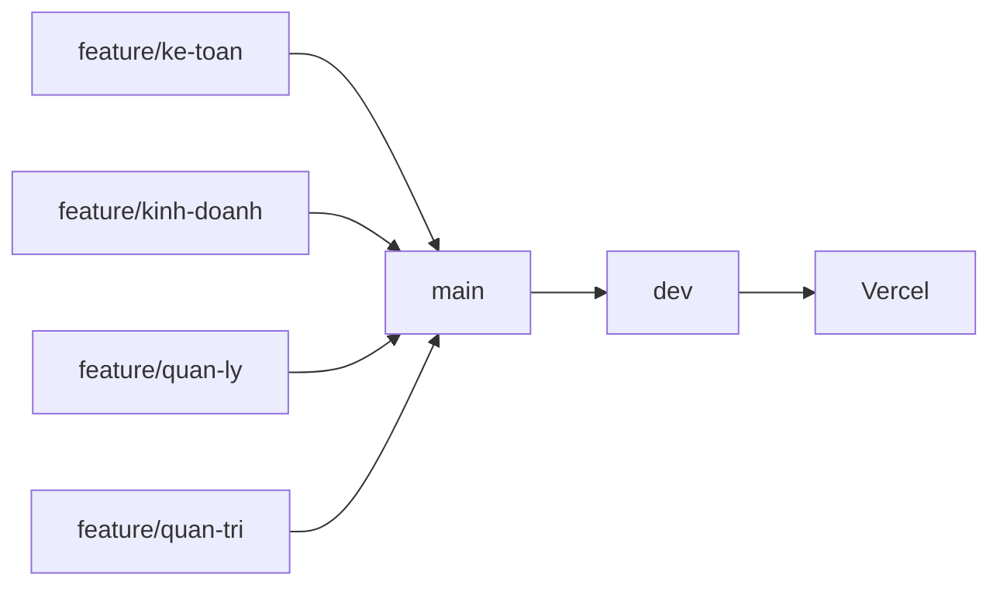

# InvoicePilot — Hệ thống Quản trị Hóa đơn & Công nợ B2B

> Bài tập lớn môn **Phát triển ứng dụng Web (CSE122)** — Đề BTL-19: *Theo dõi hóa đơn và công nợ*.
> Ứng dụng web nhiều trang (multi-page) giúp doanh nghiệp B2B lập hóa đơn, ghi nhận thanh toán, nhắc nợ khách hàng, giám sát tuổi nợ và dự báo dòng tiền — chia theo **4 nghiệp vụ**: Kế toán, Kinh doanh, Quản lý (CFO) và Quản trị viên.

| Hạng mục | Liên kết |
| :--- | :--- |
| Website trực tuyến (Vercel) | https://invoicepilot-b2b.vercel.app |
| Mã nguồn (GitHub) | https://github.com/ReacVick/invoicepilot-b2b |

---

## Mục lục
1. [Giới thiệu tổng quan](#1-giới-thiệu-tổng-quan)
2. [Tính năng theo 4 nghiệp vụ](#2-tính-năng-theo-4-nghiệp-vụ)
3. [Công nghệ sử dụng](#3-công-nghệ-sử-dụng)
4. [Cấu trúc thư mục](#4-cấu-trúc-thư-mục)
5. [Hướng dẫn cài đặt & chạy](#5-hướng-dẫn-cài-đặt--chạy)
6. [Hướng dẫn sử dụng](#6-hướng-dẫn-sử-dụng)
7. [Kiến trúc & tài liệu kỹ thuật](#7-kiến-trúc--tài-liệu-kỹ-thuật)
8. [Dữ liệu mẫu & MockAPI](#8-dữ-liệu-mẫu--mockapi)
9. [Quy trình nhánh Git & triển khai](#9-quy-trình-nhánh-git--triển-khai)
10. [Quy ước phát triển](#10-quy-ước-phát-triển)

---

## 1. Giới thiệu tổng quan

Nhiều doanh nghiệp B2B vẫn theo dõi hóa đơn và công nợ bằng Excel rời rạc: không biết khách nào sắp chạm hạn mức tín dụng, nhắc nợ chậm, kế toán và kinh doanh không chung số liệu. **InvoicePilot** gom toàn bộ vòng đời công nợ về một nơi:



**Điểm nổi bật**
- 22 màn hình, giao diện 100% tiếng Việt, chuẩn thuật ngữ kế toán – công nợ, hỗ trợ Sáng/Tối và chuyển đổi VI/EN (quy đổi USD theo tỷ giá ngày).
- Phân quyền RBAC 4 vai trò, có trang 403/404.
- 3 trợ lý AI chạy cục bộ (AI-1 kiểm tra bất thường hóa đơn, AI-2 soạn thư nhắc nợ, AI-3 dự báo dòng tiền) cùng Mini-LLM riêng cho từng nghiệp vụ; mọi kết quả AI đều có độ tin cậy %, giải thích 3 yếu tố, cho phép chấp nhận / sửa / từ chối.
- Mọi thao tác Lưu và Hủy đều có hộp thoại xác nhận, sau khi xác nhận cửa sổ đóng ngay.
- Xử lý trạng thái mạng: mạng chậm (skeleton), tra cứu đa chiều, mất kết nối (Offline Shield).
- Chạy trực tiếp bằng trình duyệt, không cần cài đặt hay build.

---

## 2. Tính năng theo 4 nghiệp vụ

### 2.1. Kế toán — `feature/ke-toan`
| Màn hình | Chức năng chính |
| :--- | :--- |
| `accountant-invoice-list.html` | Danh sách hóa đơn, thẻ KPI, lọc theo trạng thái/khách hàng/kỳ, sắp xếp, phân trang, ngăn kéo chi tiết, ghi nhận thanh toán, nhân bản, lưu trữ, xuất CSV |
| `accountant-invoice-form.html` | Lập/sửa hóa đơn nhiều dòng hàng, tự tính chiết khấu – VAT – tổng tiền, chọn nhanh kỳ hạn, thêm nhanh khách hàng, xem trước bản in A4, Trợ lý AI-1 phát hiện bất thường |
| `accountant-reconciliation.html` | Đối chiếu giao dịch ngân hàng với hóa đơn, gợi ý khớp, phân bổ một phần, đánh dấu sai lệch, từ chối, hoàn tác |

### 2.2. Kinh doanh — `feature/kinh-doanh`
| Màn hình | Chức năng chính |
| :--- | :--- |
| `sales-customer-balance.html` | Sổ công nợ khách hàng, cảnh báo hạn mức tín dụng, thanh tuổi nợ 4 tầng (0–30 / 31–60 / 61–90 / >90 ngày), ghim khách ưu tiên, hồ sơ 360°, xuất CSV |
| `sales-payment-reminders.html` | Trình soạn nhắc thanh toán 4 bước (khách hàng → hóa đơn → kênh & giọng điệu → nội dung), Trợ lý AI-2 soạn Email/SMS theo 3 giọng điệu, quản lý Nháp / Đã lên lịch / Đã gửi / Thất bại |
| `sales-invoice-detail.html` | Chi tiết hóa đơn, ghi chú nội bộ, gia hạn ngày đáo hạn bắt buộc nhập lý do, in A4 |

### 2.3. Quản lý (CFO) — `feature/quan-ly`
| Màn hình | Chức năng chính |
| :--- | :--- |
| `manager-receivable-dashboard.html` | Tổng quan phải thu, DSO, cơ cấu tuổi nợ, biểu đồ Chart.js, tóm tắt điều hành AI |
| `manager-overdue-invoices.html` | Hóa đơn quá hạn, chấm điểm rủi ro, phân công nhân sự thu hồi, nhật ký xử lý, đóng/mở theo dõi |
| `manager-cashflow-forecast.html` | Dự báo dòng tiền 30/60/90 ngày theo 3 kịch bản (lạc quan / cơ sở / thận trọng) với Trợ lý AI-3 |

### 2.4. Quản trị viên — `feature/quan-tri`
| Màn hình | Chức năng chính |
| :--- | :--- |
| `admin-customer-management.html` | CRUD khách hàng B2B, kiểm tra MST 10–13 số chống trùng, chặn lưu trữ khách còn dư nợ |
| `admin-user-management.html` | Cấp/sửa/khóa/xóa tài khoản, cấp lại mật khẩu, bảo vệ quản trị viên cuối cùng |
| `admin-invoice-settings.html` | Thông tin đơn vị phát hành, ký hiệu & đánh số hóa đơn, mẫu nhắc thanh toán, bật/tắt từng trợ lý AI, sao lưu/khôi phục dữ liệu |

### 2.5. Màn hình dùng chung
`index.html` (giới thiệu), `login.html`, `forgot-password.html`, `profile.html`, `notifications.html`, `403.html`, `404.html`, `ui-state-loading.html`, `ui-state-empty.html`, `ui-state-error.html`.

---

## 3. Công nghệ sử dụng

| Thành phần | Công nghệ |
| :--- | :--- |
| Giao diện | HTML5, CSS3 (CSS Variables, Grid, Flexbox, `@media print`) |
| Thư viện UI | Bootstrap 5.3.3, Bootstrap Icons 1.11 (CDN) |
| Biểu đồ | Chart.js 4.4 (CDN) |
| Logic | Vanilla JavaScript ES2020, mẫu IIFE + namespace `window.IP` |
| Lưu trữ | `localStorage` (dữ liệu nghiệp vụ), `sessionStorage` (cấu hình LLM tạm thời) |
| Dữ liệu đám mây | MockAPI (4 endpoint cho 4 nghiệp vụ) |
| Triển khai | GitHub + Vercel (site tĩnh) |

Dự án **không** dùng React/Vue/Angular, Tailwind, Node.js, công cụ build, ES Modules hay `fetch()` đọc JSON cục bộ — nhờ vậy mở được trực tiếp qua `file://`.

---

## 4. Cấu trúc thư mục

```text
invoicepilot-b2b/
├── index.html                         # Trang giới thiệu (cũng là trang vào Vercel)
├── login.html, forgot-password.html   # Xác thực
├── profile.html, notifications.html   # Dùng chung cho 4 vai trò
├── 403.html, 404.html                 # Trang lỗi phân quyền / không tìm thấy
├── ui-state-loading|empty|error.html  # 3 trạng thái mạng & tra cứu
├── accountant-*.html                  # 3 màn hình Kế toán
├── sales-*.html                       # 3 màn hình Kinh doanh
├── manager-*.html                     # 3 màn hình Quản lý
├── admin-*.html                       # 3 màn hình Quản trị viên
├── InvoicePilot_responsive_v3.html    # Bản tổng hợp một tệp (dùng để demo nhanh)
├── assets/
│   ├── css/
│   │   ├── tokens.css                 # Biến màu, khoảng cách, bo góc
│   │   ├── style.css, responsive.css  # Bố cục chung & responsive
│   │   └── modules/                   # accountant | sales | manager | admin | auth | ...
│   ├── js/
│   │   ├── core/                      # utils, calc, ui, auth, routes, layout, ai-core
│   │   ├── data/                      # db-*.js (tầng dữ liệu) & seed-*.js (dữ liệu mẫu)
│   │   ├── ai/                        # ai-anomaly (AI-1), ai-reminder (AI-2), ai-cashflow (AI-3)
│   │   └── pages/                     # Controller cho từng màn hình
│   ├── data/mock-data.json            # Bộ dữ liệu gộp chuẩn
│   └── img/                           # favicon.svg, logo-mark.svg
├── mockapi-data/                      # 4 tệp JSON để nạp lên MockAPI
├── SV1-*/, SV2-*/, SV3-*/             # Bản rút gọn ~300 dòng phục vụ quay video live-code
├── docs/features/                     # Tài liệu chi tiết từng nghiệp vụ
├── vercel.json
└── README.md
```

---

## 5. Hướng dẫn cài đặt & chạy

### Cách 1 — Dùng bản trực tuyến
Truy cập https://invoicepilot-b2b.vercel.app

### Cách 2 — Chạy trên máy
```bash
git clone https://github.com/ReacVick/invoicepilot-b2b.git
cd invoicepilot-b2b
```
Sau đó chọn một trong hai:
- Mở trực tiếp `index.html` (hoặc bất kỳ trang `.html` nào) bằng trình duyệt; hoặc
- Dùng tiện ích **Live Server** của VS Code: chuột phải `index.html` → *Open with Live Server*.

> Cần kết nối Internet lần đầu để tải Bootstrap, Bootstrap Icons, Chart.js và font từ CDN.

### Yêu cầu trình duyệt
Chrome, Edge, Firefox hoặc Safari bản mới (hỗ trợ ES2020).

---

## 6. Hướng dẫn sử dụng

### 6.1. Tài khoản dùng thử
| Vai trò | Email | Mật khẩu |
| :--- | :--- | :--- |
| Kế toán | `ketoan@hoabinhdigital.vn` | `KeToan@2026` |
| Kinh doanh | `kinhdoanh@hoabinhdigital.vn` | `KinhDoanh@2026` |
| Quản lý | `quanly@hoabinhdigital.vn` | `QuanLy@2026` |
| Quản trị viên | `admin@hoabinhdigital.vn` | `Admin@2026` |

Có thể đổi nhanh vai trò bằng menu **Chuyển vai trò** trên thanh công cụ. Mở trực tiếp một trang nghiệp vụ (ví dụ `sales-customer-balance.html`) sẽ tự đăng nhập đúng vai trò của trang đó để tiện demo.

### 6.2. Kịch bản demo nhanh (khoảng 5 phút)
1. **Kế toán** → *Tạo hóa đơn* → chọn khách hàng, thêm dòng hàng → *Lưu & Gửi* → xác nhận → quay về danh sách.
2. Trong danh sách, mở hóa đơn vừa tạo → *Ghi nhận thanh toán* một phần → xác nhận → trạng thái chuyển *Thanh toán một phần*.
3. **Kinh doanh** → *Công nợ khách hàng* → xem thanh tuổi nợ → *Tạo nhắc thanh toán* → dùng AI-2 soạn thư → *Gửi ngay* → xác nhận.
4. **Quản lý** → *Hóa đơn quá hạn* → phân công nhân sự → xác nhận; xem *Dự báo dòng tiền* 3 kịch bản.
5. **Quản trị viên** → *Quản lý khách hàng* → thử lưu trữ khách còn nợ (hệ thống chặn) → thêm khách hàng mới.

### 6.3. Thao tác chung
- **Lưu**: luôn hỏi "Bạn có chắc chắn muốn lưu…?" → *Chắc chắn lưu & Thoát*.
- **Hủy / Đóng**: với cửa sổ có biểu mẫu, hỏi "Bạn có chắc chắn muốn hủy…?" → *Chắc chắn hủy & Thoát*.
- **Nút Quay lại của trình duyệt** hoạt động giữa các màn hình.
- **Hồ sơ cá nhân → Giao diện & Dữ liệu**: đổi Sáng/Tối, xuất sao lưu JSON, khôi phục dữ liệu mẫu.

---

## 7. Kiến trúc & tài liệu kỹ thuật

### 7.1. Các lớp trong `window.IP`
| Namespace | Trách nhiệm |
| :--- | :--- |
| `IP.Utils` | Escape HTML, debounce, đọc/ghi query string, sinh ID |
| `IP.Fmt` | Định dạng tiền VND, ngày `dd/mm/yyyy`, nhãn trạng thái |
| `IP.Calc` | Tổng tiền, VAT, số còn phải thu, trạng thái hiệu lực, tuổi nợ, DSO |
| `IP.DB` | Đọc/ghi `localStorage`, validate, phát sự kiện thay đổi (`subscribe`) |
| `IP.Seed` | Đăng ký và nạp dữ liệu mẫu |
| `IP.Auth` | Đăng nhập, phiên, phân quyền `guard(roles)`, chuyển vai trò |
| `IP.UI` | Toast, `confirmModal`, `closeModal`, modal thanh toán, phân trang, empty/error/skeleton, in A4 |
| `IP.AI` | Khung trợ lý AI 6 bước & đăng ký engine |
| `IP.Pages` | Đăng ký controller theo `data-page` |
| `IP.Layout` | Dựng sidebar, topbar và khởi động trang |

### 7.2. Vòng đời một trang


### 7.3. Quy tắc dữ liệu
- Tiền lưu dạng **số nguyên VND**; ngày lưu dạng **ISO `YYYY-MM-DD`**.
- `paidAmount` và trạng thái hóa đơn **luôn được dẫn xuất** từ các giao dịch thanh toán `confirmed`, không sửa tay.
- Mọi hàm ghi trả về `{ ok: true, data }` hoặc `{ ok: false, error: { field, message } }`.

### 7.4. Trợ lý AI 6 bước
Đầu vào → Xử lý → Kết quả (Phương án A/B) → Giải thích (độ tin cậy % + 3 yếu tố) → Người dùng kiểm soát (Chấp nhận / Sửa / Từ chối / Tạo lại / Báo cáo / Làm thủ công) → Lưu vào trạng thái ứng dụng. Có thể kết nối LLM ngoài; mã kết nối chỉ lưu trong `sessionStorage` và tự quay về bộ quy tắc nội bộ khi trống hoặc mất mạng.

Tài liệu chi tiết từng nghiệp vụ nằm trong [`docs/features/`](docs/features/).

---

## 8. Dữ liệu mẫu & MockAPI

| Tệp | Nghiệp vụ |
| :--- | :--- |
| `mockapi-data/1-mockapi-ketoan-invoices.json` | Kế toán — hóa đơn & thanh toán |
| `mockapi-data/2-mockapi-kinhdoanh-reminders.json` | Kinh doanh — nhắc thanh toán & tuổi nợ |
| `mockapi-data/3-mockapi-quanly-cashflow.json` | Quản lý — dòng tiền & DSO |
| `mockapi-data/4-mockapi-quantri-system.json` | Quản trị — khách hàng, tài khoản, cấu hình |
| `assets/data/mock-data.json` | Bộ gộp cả 4 tệp trên |

**Nạp lên MockAPI**: tạo project trên mockapi.io → tạo resource cho từng nghiệp vụ → dán nội dung JSON tương ứng → nhập 4 URL vào cửa sổ **MockAPI Cloud** trên thanh công cụ của ứng dụng.

Dữ liệu mẫu gồm 18 doanh nghiệp B2B thuộc 8 ngành và khoảng 50 hóa đơn trải đủ các trạng thái. Có thể khôi phục bất cứ lúc nào tại *Hồ sơ cá nhân → Khôi phục dữ liệu chuẩn ban đầu*.

---

## 9. Quy trình nhánh Git & triển khai

| Nhánh | Mục đích |
| :--- | :--- |
| `main` | Nhánh tổng hợp toàn bộ mã nguồn ổn định của cả nhóm |
| `dev` | Nhánh triển khai lên **Vercel** |
| `feature/ke-toan` | Phát triển nghiệp vụ Kế toán |
| `feature/kinh-doanh` | Phát triển nghiệp vụ Kinh doanh |
| `feature/quan-ly` | Phát triển nghiệp vụ Quản lý (CFO) |
| `feature/quan-tri` | Phát triển nghiệp vụ Quản trị viên |



**Quy trình làm việc**
```bash
# 1. Lấy code mới nhất và làm trên nhánh nghiệp vụ của mình
git checkout feature/kinh-doanh
git pull origin main

# 2. Commit theo quy ước
git add .
git commit -m "feat(kinh-doanh): thêm bộ lọc tuổi nợ 61-90 ngày"
git push origin feature/kinh-doanh

# 3. Tạo Pull Request feature/kinh-doanh -> main trên GitHub, review rồi merge

# 4. Đưa main lên dev để Vercel tự triển khai
git checkout dev
git merge main
git push origin dev
```

**Cấu hình Vercel**: *Project → Settings → Git → Production Branch* = `dev`. Mỗi lần push lên `dev`, Vercel tự build và cập nhật https://invoicepilot-b2b.vercel.app.

---

## 10. Quy ước phát triển

- Chỉ dùng HTML5, CSS3, Vanilla JS ES2020, Bootstrap 5.3, Chart.js 4, Bootstrap Icons qua CDN.
- Không dùng `alert()`, `confirm()`, `prompt()` — dùng `IP.UI.confirmModal` và `IP.UI.toast`.
- Không dùng ảnh stock, ảnh AI hay emoji trong giao diện — chỉ inline SVG và Bootstrap Icons.
- Giao diện, thông báo, dữ liệu mẫu: 100% tiếng Việt, xưng hô "bạn".
- Mọi đọc/ghi dữ liệu nghiệp vụ đi qua `IP.DB`, mọi tính toán đi qua `IP.Calc`.
- Mở rộng qua cơ chế đăng ký: `IP.DB.extend`, `IP.Seed.register`, `IP.AI.register`, `IP.Pages.register`.
- Commit message: `feat(...)`, `fix(...)`, `docs(...)`, `style(...)`, `refactor(...)`.

---

© 2026 Nhóm InvoicePilot — Bài tập lớn môn Phát triển ứng dụng Web (CSE122), lớp 67KTPM.
